<div align="center">

  <!-- Banner -->
  

  <br/><br/>

  <!-- Typing tagline -->
  <a href="https://github.com/Akhil-Binu">
    
  </a>

  <br/>

  <!-- Quick actions -->
  <a href="https://akhilbinu.in/" target="_blank"></a>
  <a href="https://www.linkedin.com/in/akhilbinu/" target="_blank"></a>
  <a href="mailto:AkhilBinuRoom@gmail.com"></a>
  

</div>

## // whoami

```console
$ whoami
cybersecurity engineer & security researcher — offense-minded, defense-built

$ cat focus.txt
appsec · threat-intel · pentesting · secure full-stack engineering (python · ts · c)

$ ./status.sh --live
● open_to_collaborations = true
● research_and_writeups  = akhilbinu.in
```

**What that means in practice:**

* 🔐 **Break & harden** — OWASP-driven assessments, secure code audits, automated SAST/DAST scanning
* 🎯 **Detect & hunt** — anti-phishing classifiers, URL inspection heuristics, browser security extensions, malware-intel lookups
* ⚙️ **Build systems** — POSIX C network programming, compiler construction, production Python & TypeScript applications

## // tech_stack

<div align="center">
  
  <br/><br/>
  🔒 <code>Kali Linux</code> <code>Nmap / NSE</code> <code>Wireshark</code> <code>Burp Suite</code> <code>OWASP Top 10</code> <code>OSINT &amp; Recon</code> <code>Threat Modeling</code>
</div>

<details>
<summary><b>// expand full inventory</b></summary>
<br/>

* **Languages** — Python 3, TypeScript, JavaScript (ES6+), C (POSIX/C99), Bash/Shell, SQL/SQLite, HTML5/CSS3
* **Frameworks & Web** — React/Vite, Node.js/Express, FastAPI, Django (MVT), Flask, Tailwind CSS, PyQt5/QtWebEngine
* **Infrastructure & Tooling** — Linux/Ubuntu, Git/GitHub, Docker, Postman, VS Code/Vim, Vercel, PythonAnywhere

</details>

## // featured_systems

*Production-grade platforms — every one ships with a live deployment.*

<table>
  <tr>
    <td width="50%" valign="top">
      <h3>🧾 <a href="https://github.com/Akhil-Binu/fraudcheck">FraudCheck</a></h3>
      <i>Tampered-invoice &amp; document forensics platform</i><br/><br/>
      Catches invoice spoofing, document tampering, wire-detail redirection, and retroactive metadata edits before payments go out the door.
      <ul>
        <li>Error Level Analysis, visual artifact scanning &amp; font-mismatch detection</li>
        <li>Automated IBAN / IFSC / wire-transfer routing verification</li>
      </ul>
      <code>FastAPI</code> <code>React 18</code> <code>PyMuPDF</code> <code>OpenCV</code> <code>Tailwind</code><br/><br/>
      <a href="https://fraudcheck-taupe.vercel.app" target="_blank"><b>Live Demo ↗</b></a> &nbsp;·&nbsp; <a href="https://github.com/Akhil-Binu/fraudcheck"><b>Source ↗</b></a>
    </td>
    <td width="50%" valign="top">
      <h3>🛡️ <a href="https://github.com/Akhil-Binu/SecretShield">SecretShield</a></h3>
      <i>Git secret-leak auditor — shift-left DevSecOps</i><br/><br/>
      High-velocity scanner that flags exposed API keys, private credentials, and high-entropy secrets across repos and commit history — before someone else finds them.
      <ul>
        <li>Shannon entropy engine + 100+ precision token signature heuristics</li>
        <li>Direct git tree inspection, pre-commit config generator &amp; remediation</li>
      </ul>
      <code>FastAPI</code> <code>Docker</code> <code>Entropy Engine</code><br/><br/>
      <a href="https://huggingface.co/spaces/akhilbinu/secretshield" target="_blank"><b>Live Demo ↗</b></a> &nbsp;·&nbsp; <a href="https://github.com/Akhil-Binu/SecretShield"><b>Source ↗</b></a>
    </td>
  </tr>
  <tr>
    <td width="50%" valign="top">
      <h3>💰 <a href="https://github.com/Akhil-Binu/personal-expense-tracker">FinanceFlow</a></h3>
      <i>Production personal wealth &amp; expense platform</i><br/><br/>
      Full-stack money tracker with multi-account wealth views, AI-assisted receipt parsing, and hardened authentication — running in production.
      <ul>
        <li>Receipt OCR parsing &amp; automated expense categorization</li>
        <li>Two-factor authentication, PWA install &amp; Excel report export</li>
      </ul>
      <code>Flask 3.1</code> <code>SQLite</code> <code>OCR</code> <code>PWA</code><br/><br/>
      <a href="https://akhilbinu.pythonanywhere.com/" target="_blank"><b>Live Demo ↗</b></a> &nbsp;·&nbsp; <a href="https://github.com/Akhil-Binu/personal-expense-tracker"><b>Source ↗</b></a>
    </td>
    <td width="50%" valign="top">
      <h3>🎯 <a href="https://github.com/Akhil-Binu/Akhil-PhishGuard">PhishGuard</a></h3>
      <i>Anti-phishing threat detection suite</i><br/><br/>
      Analyzes malicious URLs and deceptive domains in real time to blunt credential harvesting and social-engineering attacks before users click through.
      <ul>
        <li>Real-time domain reputation &amp; lexical heuristic scoring</li>
        <li>Threat-intelligence feed integration &amp; spoofing detection</li>
      </ul>
      <code>Python</code> <code>JavaScript</code> <code>Threat Intel APIs</code><br/><br/>
      <a href="https://akhil-phish-guard.vercel.app/" target="_blank"><b>Live Demo ↗</b></a> &nbsp;·&nbsp; <a href="https://github.com/Akhil-Binu/Akhil-PhishGuard"><b>Source ↗</b></a>
    </td>
  </tr>
</table>

## // more_builds

| System | What it does | Links |
| --- | --- | --- |
| **[Akhil WebGuard](https://github.com/Akhil-Binu/Akhil-Website-Scanner)** | Async web vuln scanner — missing security headers, open attack vectors, posture scoring, automated PDF compliance reports | [Live ↗](https://akhil-website-scanner.vercel.app/) · [Code ↗](https://github.com/Akhil-Binu/Akhil-Website-Scanner) |
| **[PhishLab](https://github.com/Akhil-Binu/Phishing_simulation)** | Security-awareness sandbox — 7 social-engineering simulations with a *Bait → Reveal → Defend* pedagogy | [Live ↗](https://phishing-simulation-ecru.vercel.app) · [Code ↗](https://github.com/Akhil-Binu/Phishing_simulation) |
| **[Sub-Domain-Enumerator](https://github.com/Akhil-Binu/SUB-DOMAIN-ENUMERATOR)** | OSINT recon utility — fast DNS resolution, wildcard record filtering, exportable attack-surface datasets | [Live ↗](https://sub-domain-enumerator.vercel.app) · [Code ↗](https://github.com/Akhil-Binu/SUB-DOMAIN-ENUMERATOR) |
| **[Akhil Fortress](https://github.com/Akhil-Binu/Password-Strength-Checker)** | Zero-knowledge password auditor — Shannon entropy, brute-force resistance &amp; leetspeak detection, 100% client-side | [Live ↗](https://akhil-password-strength-checker.vercel.app/) · [Code ↗](https://github.com/Akhil-Binu/Password-Strength-Checker) |

## // foundations

Reference implementations for low-level systems, networking, and security education:

* ⚙️ **[Compiler Design Suite](https://github.com/Akhil-Binu/Compiler-Lab)** — `KTU CSL331` · Complete 13-program compiler pipeline: Flex/Bison parsers, NFA→DFA subset construction, three-address code generation, loop-unrolling optimization
* 🌐 **[Network Architecture & Sockets](https://github.com/Akhil-Binu/network-lab)** — `KTU CSL332` · POSIX C suite: TCP/UDP models, custom FTP/SMTP protocol engines, sliding-window flow control (Go-Back-N, Selective Repeat), Leaky Bucket traffic shaping
* 🧭 **[The Interactive Nmap Field Guide](https://github.com/Akhil-Binu/Nmap_Guide)** — Web app comparing TCP SYN, Connect, UDP & stealth scans with dynamic Chart.js metric visualizations

## // telemetry

<div align="center">
  <table border="0">
    <tr>
      <td align="center"></td>
      <td align="center"></td>
    </tr>
  </table>

  <br/>

  
</div>

---

## // ping_me

<p align="center">
  Security research collaborations, open-source tooling, or application security consultations — my inbox is open.
</p>

<p align="center">
  <a href="https://akhilbinu.in/" target="_blank"></a>
  <a href="https://www.linkedin.com/in/akhilbinu/" target="_blank"></a>
  <a href="https://github.com/Akhil-Binu" target="_blank"></a>
  <a href="mailto:AkhilBinuRoom@gmail.com"></a>
</p>

<div align="center">
  <sub>🛡️ Profile views: </sub><br/><br/>
  <sub><code>// end of transmission</code></sub>
</div>
