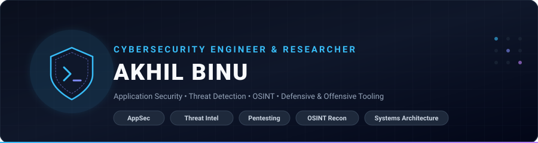

  <!-- Custom Cyber Vector Banner -->
  

    

  <!-- Dynamic Typing Sub-banner -->
  

  <!-- Minimalist Quick-Action Badges -->
  

    
    
    
    
    
  

---

### 🛡️ Executive Summary

I am a **Cybersecurity Engineer and Security Researcher** specializing in **Application Security (AppSec)**, **Threat Intelligence**, and **Security Automation**. With deep foundations in both offensive security (penetration testing, exploit behavior, attack surface mapping) and defensive software engineering, I design and build resilient open-source tools and enterprise-grade web applications.

* 🔐 **Application Security:** Vulnerability assessment, OWASP Top 10 mitigation, secure code auditing, and automated AST/DAST scanning.
* 🎯 **Threat Detection:** Anti-phishing classifiers, real-time URL inspection heuristics, browser security extensions, and malware intelligence querying.
* ⚙️ **Systems & Architecture:** Multi-threaded network programming in C (POSIX sockets), compiler construction (Lex/Yacc), and full-stack development with Python, TypeScript, and modern frameworks.
* 🌐 **Active Research & Writeups:** Practical security breakdowns, project demos, and research notes published on [akhilbinu.in](https://akhilbinu.in/).

---

### 🧰 Technical Arsenal

<table width="100%">
  <tr>
    <td width="25%" valign="top">
      <h4>🔒 Security &amp; Recon</h4>
      

        • Kali Linux 
        • Nmap / NSE 
        • Wireshark 
        • Burp Suite 
        • OWASP Top 10 
        • OSINT &amp; Recon 
        • Threat Modeling
      

    </td>
    <td width="25%" valign="top">
      <h4>💻 Languages</h4>
      

        • Python 3 
        • TypeScript 
        • JavaScript (ES6+) 
        • C (POSIX / C99) 
        • Bash / Shell 
        • SQL / SQLite 
        • HTML5 / CSS3
      

    </td>
    <td width="25%" valign="top">
      <h4>🌐 Frameworks &amp; Web</h4>
      

        • React / Vite 
        • Node.js / Express 
        • FastAPI 
        • Django (MVT) 
        • Flask 3.x 
        • Tailwind CSS 
        • PyQt5 / QtWebEngine
      

    </td>
    <td width="25%" valign="top">
      <h4>⚙️ Infrastructure &amp; Tools</h4>
      

        • Linux / Ubuntu 
        • Git &amp; GitHub 
        • Docker Containers 
        • Postman API Client 
        • VS Code / VIM 
        • Vercel Platform 
        • PythonAnywhere
      

    </td>
  </tr>
</table>

  

---

### 🚀 Featured Engineering & Security Systems

<table>
  <!-- Row 1: Forensics & DevSecOps Flagships -->
  <tr>
    <td width="50%" valign="top">
      <h3>🧾 <a href="https://github.com/Akhil-Binu/fraudcheck">FraudCheck</a></h3>
      
<b>Tampered Invoice &amp; Digital Document Forensics Platform</b>

      
An enterprise-grade document forensics platform designed to detect invoice spoofing, digital document tampering, wire detail redirection, and retroactive metadata alterations.

      <ul>
        <li>Error Level Analysis (ELA), visual artifact scanning &amp; font mismatch detection</li>
        <li>Automated IBAN, IFSC, and wire transfer payment detail routing verification</li>
      </ul>
      
<b>Stack:</b> <code>FastAPI (Python)</code> <code>React 18</code> <code>PyMuPDF</code> <code>OpenCV</code> <code>Tailwind</code>

      

        <a href="https://fraudcheck-taupe.vercel.app" target="_blank"><b>Live Demo ↗</b></a> &nbsp;|&nbsp; 
        <a href="https://github.com/Akhil-Binu/fraudcheck"><b>Repository ↗</b></a>
      

    </td>
    <td width="50%" valign="top">
      <h3>🛡️ <a href="https://github.com/Akhil-Binu/SecretShield">SecretShield</a></h3>
      
<b>Instant Git Secret &amp; API Key Leak Auditor (Shift-Left DevSecOps)</b>

      
High-velocity scanner detecting exposed API keys, private credentials, and high-entropy secrets across repositories and commits before public exploitation.

      <ul>
        <li>Shannon entropy calculation and 100+ precision token signature heuristics</li>
        <li>Direct git tree inspection, pre-commit configuration generator &amp; remediation</li>
      </ul>
      
<b>Stack:</b> <code>FastAPI</code> <code>Docker</code> <code>Entropy Engine</code> <code>DevSecOps</code>

      

        <a href="https://huggingface.co/spaces/akhilbinu/secretshield" target="_blank"><b>Live Demo ↗</b></a> &nbsp;|&nbsp; 
        <a href="https://github.com/Akhil-Binu/SecretShield"><b>Repository ↗</b></a>
      

    </td>
  </tr>
  <!-- Row 2: Production Applications & Threat Intelligence -->
  <tr>
    <td width="50%" valign="top">
      <h3>💰 <a href="https://github.com/Akhil-Binu/personal-expense-tracker">FinanceFlow (v2.0)</a></h3>
      
<b>Production Personal Wealth &amp; Expense Management Platform</b>

      
A full-stack financial tracker engineered for multi-account wealth tracking, automated financial intelligence, and enterprise-grade authentication.

      <ul>
        <li>AI-assisted Receipt OCR parsing &amp; automated expense categorization</li>
        <li>Two-Factor Authentication (2FA), PWA support &amp; Excel report export</li>
      </ul>
      
<b>Stack:</b> <code>Flask 3.1</code> <code>SQLite</code> <code>OCR AI</code> <code>PWA</code> <code>Bootstrap</code>

      

        <a href="https://akhilbinu.pythonanywhere.com/" target="_blank"><b>Live Demo ↗</b></a> &nbsp;|&nbsp; 
        <a href="https://github.com/Akhil-Binu/personal-expense-tracker"><b>Repository ↗</b></a>
      

    </td>
    <td width="50%" valign="top">
      <h3>🛡️ <a href="https://github.com/Akhil-Binu/Akhil-PhishGuard">Akhil-PhishGuard</a></h3>
      
<b>Intelligent Threat Detection &amp; Anti-Phishing Protection Suite</b>

      
An automated security suite engineered to analyze malicious URLs, inspect deceptive domains, and protect end-users from sophisticated social engineering vectors.

      <ul>
        <li>Real-time domain reputation and lexical heuristic scoring</li>
        <li>Integrates threat intelligence feeds and spoofing detection</li>
      </ul>
      
<b>Stack:</b> <code>Python</code> <code>JavaScript</code> <code>Threat Intel APIs</code>

      

        <a href="https://akhil-phish-guard.vercel.app/" target="_blank"><b>Live Demo ↗</b></a> &nbsp;|&nbsp; 
        <a href="https://github.com/Akhil-Binu/Akhil-PhishGuard"><b>Repository ↗</b></a>
      

    </td>
  </tr>
  <!-- Row 3: Scanners & Security Education -->
  <tr>
    <td width="50%" valign="top">
      <h3>🔍 <a href="https://github.com/Akhil-Binu/Akhil-Website-Scanner">Akhil WebGuard</a></h3>
      
<b>Enterprise Web Vulnerability Scanner &amp; Footprinting Tool</b>

      
Asynchronous security auditing engine evaluating target URL postures, missing defensive headers, open attack vectors, and automated PDF compliance reports.

      <ul>
        <li>Concurrent multi-threaded endpoint probes</li>
        <li>Automated security posture scoring and remediation advisories</li>
      </ul>
      
<b>Stack:</b> <code>Node.js</code> <code>Express</code> <code>Security Scanners</code>

      

        <a href="https://akhil-website-scanner.vercel.app/" target="_blank"><b>Live Demo ↗</b></a> &nbsp;|&nbsp; 
        <a href="https://github.com/Akhil-Binu/Akhil-Website-Scanner"><b>Repository ↗</b></a>
      

    </td>
    <td width="50%" valign="top">
      <h3>🎯 <a href="https://github.com/Akhil-Binu/Phishing_simulation">PhishLab Training Platform</a></h3>
      
<b>Interactive Social Engineering Simulation Laboratory</b>

      
An educational security awareness training platform walking trainees through real-world attack vectors in a secure, browser-isolated sandbox.

      <ul>
        <li>7 attack simulations (Credential Harvesting, Spoofing, Homoglyphs)</li>
        <li>3-phase pedagogy: <i>Bait → Reveal → Defense Mitigations</i></li>
      </ul>
      
<b>Stack:</b> <code>HTML5</code> <code>JavaScript</code> <code>Tailwind CSS</code>

      

        <a href="https://phishing-simulation-ecru.vercel.app" target="_blank"><b>Live Demo ↗</b></a> &nbsp;|&nbsp; 
        <a href="https://github.com/Akhil-Binu/Phishing_simulation"><b>Repository ↗</b></a>
      

    </td>
  </tr>
  <!-- Row 4: OSINT & Cryptographic Security -->
  <tr>
    <td width="50%" valign="top">
      <h3>🌐 <a href="https://github.com/Akhil-Binu/SUB-DOMAIN-ENUMERATOR">SUB-DOMAIN-ENUMERATOR</a></h3>
      
<b>High-Velocity OSINT Reconnaissance Utility</b>

      
Reconnaissance tool designed for penetration testers and bug bounty researchers to enumerate active subdomains and map organization attack surfaces.

      <ul>
        <li>Fast DNS resolution and wild-card record filtering</li>
        <li>Clean, exportable reconnaissance dataset formatting</li>
      </ul>
      
<b>Stack:</b> <code>Python</code> <code>JavaScript</code> <code>DNS Recon</code>

      

        <a href="https://sub-domain-enumerator.vercel.app" target="_blank"><b>Live Demo ↗</b></a> &nbsp;|&nbsp; 
        <a href="https://github.com/Akhil-Binu/SUB-DOMAIN-ENUMERATOR"><b>Repository ↗</b></a>
      

    </td>
    <td width="50%" valign="top">
      <h3>🔑 <a href="https://github.com/Akhil-Binu/Password-Strength-Checker">Akhil Fortress</a></h3>
      
<b>Zero-Knowledge Mathematical Entropy Evaluator</b>

      
A client-side authentication defense dashboard measuring information-theoretic Shannon entropy, brute-force resistance, and dictionary vulnerability.

      <ul>
        <li>Zero data transmission — runs 100% inside local browser sandbox</li>
        <li>Detects complex leetspeak variations and personal identity leaks</li>
      </ul>
      
<b>Stack:</b> <code>TypeScript</code> <code>React</code> <code>Cryptography</code>

      

        <a href="https://akhil-password-strength-checker.vercel.app/" target="_blank"><b>Live Demo ↗</b></a> &nbsp;|&nbsp; 
        <a href="https://github.com/Akhil-Binu/Password-Strength-Checker"><b>Repository ↗</b></a>
      

    </td>
  </tr>
</table>

---

### 🔬 Academic & Foundational Systems Suite

Beyond high-level web applications, I maintain reference implementations for low-level systems programming, network architectures, and compiler design:

* ⚙️ **[`KTU CSL331: Compiler Design Suite`](https://github.com/Akhil-Binu/Compiler-Lab)** — Complete 13-program compiler implementation tracing Lexical Analysis, Flex/Bison Yacc Parsers, Automaton subset construction (NFA $\\rightarrow$ DFA), Three-Address Code generation, and loop unrolling optimization.
* 🌐 **[`KTU CSL332: Network Architecture & Sockets`](https://github.com/Akhil-Binu/network-lab)** — POSIX C socket programming suite implementing TCP/UDP models, custom FTP/SMTP protocol engines, Sliding Window flow control (Stop-and-Wait, Go-Back-N, Selective Repeat), and Leaky Bucket traffic shaping.
* 🧭 **[`The Interactive Nmap Field Guide`](https://github.com/Akhil-Binu/Nmap_Guide)** — Interactive web application comparing TCP SYN, Connect, UDP, and stealth scans with dynamic Chart.js metric visualizations.

---

### 📊 Engineering Telemetry & Activity

  <table border="0">
    <tr>
      <td align="center">
        
      </td>
      <td align="center">
        
      </td>
    </tr>
  </table>

   

  <!-- High-uptime Demolab Streak Stats -->
  

---

### 🤝 Connect & Collaborate

  Interested in security research collaborations, open-source tooling, or application security consultations? Let's connect.

  
  
  
  

  🛡️ Profile Views: 

